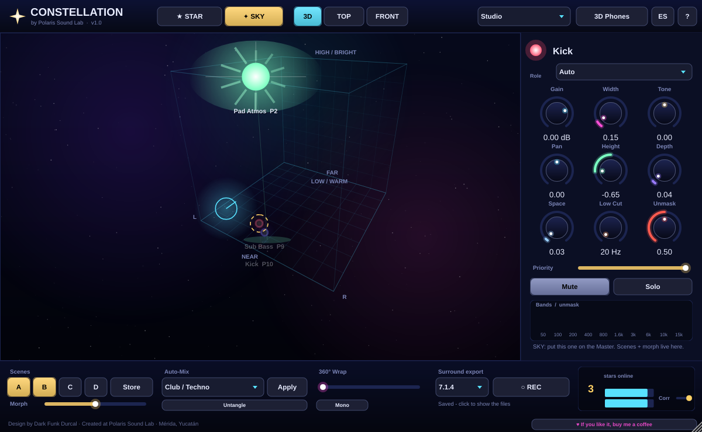
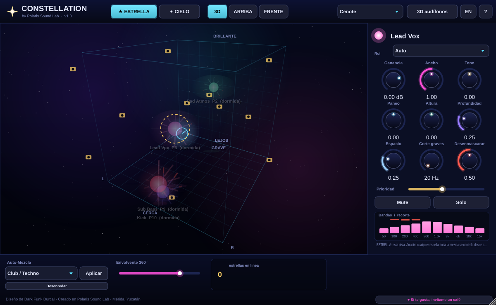
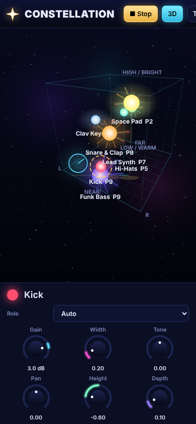
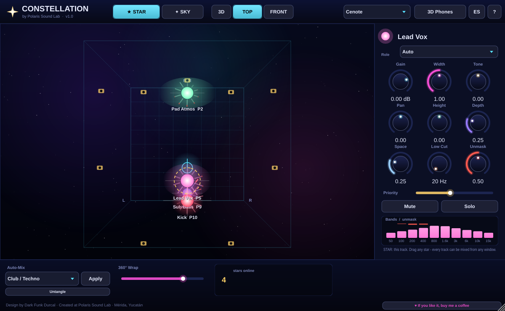

<p align="center"><a href="https://drophlex.github.io/CONSTELLATION/"></a></p>

<h1 align="center">✦ CONSTELLATION ✦</h1>
<p align="center"><b>Mix by moving stars</b><br>
3D visual mixer · 3D-aware spectral unmasking · binaural &amp; surround up to 7.1.4<br>
<i>30-day full trial · US$39 licence · made for Ableton Live · works in any DAW</i></p>

<p align="center">
<a href="https://drophlex.github.io/CONSTELLATION/"></a>
<a href="https://github.com/drophlex/CONSTELLATION/releases/latest"></a>
</p>
<p align="center">
<a href="https://drophlex.github.io/CONSTELLATION/"><b>🌐 Web version</b></a> ·
<a href="manual/Constellation-Manual-EN.pdf"><b>📗 Manual (English)</b></a> · <a href="manual/Constellation-Manual-EN-ES.pdf"><b>English + Español</b></a> ·
<a href="https://github.com/drophlex/CONSTELLATION/releases/latest"><b>⬇ Latest release</b></a> ·
<a href="#español"><b>Español</b></a>
</p>

Everything comes **in English**; press **ES** (top right of the plugin and the web) for **Spanish**. The manual comes in English, Spanish and both.

---

## ✨ Why everyone will want it

| | |
|---|---|
| ✦ **Your mix is a sky** | Every track is a star. Left/right = pan, up/down = height, into the screen = **depth** (level, air, room and pre-delay — like a real stage). Size = loudness, corona = spectrum. |
| ⚡ **No routing at all** | Insert it on your tracks: they appear instantly, with **Ableton's track names and colours**. Any window can mix every track. No sends, no returns, no sidechains. |
| ◎ **3D-aware Unmask** | Lower-priority stars dip **only** the bands where a higher-priority star is playing — and **less when they are far apart in space**. Red filaments show every clash. |
| ✧ **Auto-Mix in one click** | Reads your track names (*Kick, Bajo, Lead Vox, Pad…*, English or Spanish) and lays out a full mix: Club, Funk, Hip-Hop, Ambient, Live Band, Wide Pop, Immersive 360°. **Untangle** fixes what still clashes. |
| ⏺ **Surround export from Ableton** | Live's tracks are stereo — CONSTELLATION isn't. Arm **REC** on the SKY, export as usual and get a real **5.1 / 7.1 / 7.1.4 WAV** plus a binaural version, sample-locked to your song. |
| 🎧 **Surround everywhere** | **3D Phones** = binaural surround on any headphones (works inside Ableton). Real **Quad · 5.1 · 7.1 · 5.1.2 · 5.1.4 · 7.1.2 · 7.1.4** in DAWs with surround buses. **360° Wrap** puts the listener inside the constellation. |
| ⛰ **One shared room** | Dry Booth, Studio, Club, Plate, Concert Hall, **Cenote**, Cathedral, Nebula — every star in the same space, so depth glues the mix. |
| ⇢ **Scenes + Morph** | Store 4 complete mixes and **automate Morph** in Live to fly the whole mix from verse to chorus. |

## ⚡ Quick guide

### 🎹 Plugin in Ableton Live (Mac and Windows)



1. Download **CONSTELLATION-macOS.zip** or **CONSTELLATION-Windows.zip** from the **[latest release](https://github.com/drophlex/CONSTELLATION/releases/latest)**.
2. Mac: right-click **install-mac.command** → **Open**. Windows: double-click **install-windows.bat** → **Yes**.
3. Live → **Settings → Plug-Ins** → *Use VST3 Plug-in System Folders* → **Rescan**.
4. Put **Constellation (VST3)** last on every track (**★ STAR**) and one more on the **Master** (**✦ SKY**).
5. SKY → **Auto-Mix** → *Funk / Disco* → **Apply** → **Untangle**. Drag the stars. **?** = quick guide · **ES** = Spanish.

<br clear="right">

### 🌐 In the browser (computer or phone)



1. Open **[▶ TRY IT NOW](https://drophlex.github.io/CONSTELLATION/)** and press **Start the demo mix** (headphones for 3D Phones).
2. Drag the stars, try the Auto-Mix styles, press **3D Phones** and raise **360° Wrap**.
3. **Drop your own audio files** on the page: each one becomes a star.

<br clear="right">

<p align="center"><br><i>TOP view on a 7.1.4 output with 360° Wrap: the gold boxes are the speakers.</i></p>

## ⬇ Downloads

| | |
|---|---|
| ▶ **Web version** | [Open in the browser](https://drophlex.github.io/CONSTELLATION/) · [.html file](web/index.html) (works offline, computer or phone) |
| 🎹 **Plugin (Mac, Windows)** | [Latest release](https://github.com/drophlex/CONSTELLATION/releases/latest): VST3 + AU (macOS universal) · VST3 (Windows 10/11) |
| 📗 **Manuals** | [English](manual/Constellation-Manual-EN.pdf) · [English + Español](manual/Constellation-Manual-EN-ES.pdf) · [Español](manual/Constellation-Manual-ES.pdf) |

## ❓ FAQ

<details><summary><b>How much is it?</b></summary>
The plugin is <b>complete for 30 days</b>. Then one licence, <b>US$39 once</b>, keeps it working forever: one person, all your computers, Mac and Windows, VST3 and AU, every 1.x update. Buy it from the gold <b>Trial</b> button inside the plugin (PayPal); the key arrives by e-mail. The web version is a free demo. The source code stays public (GPL-3.0).
</details>
<details><summary><b>Surround in Ableton Live?</b></summary>
Yes. Mix on headphones with <b>3D Phones</b>; then on the SKY (Master) choose 5.1 / 7.1 / 7.1.4, press <b>REC</b> and export as usual: you get a multichannel WAV (Music › Constellation Surround) plus a binaural WAV. In DAWs with surround buses (Logic, Reaper, Cubase/Nuendo…) Constellation also plays live on real speakers.
</details>
<details><summary><b>Which file do I upload to Spotify / DistroKid?</b></summary>
One stereo export from Live with <b>3D Phones OFF</b> — the same single file for every platform. Never upload the binaural file or an export made with 3D Phones on (it is a headphone-only render). A Dolby Atmos version is optional: turn the 7.1.4 WAV into an ADM BWF in the Dolby Atmos Renderer and add it in DistroKid's "Dolby Atmos / Spatial audio" section together with the stereo file. Spotify plays stereo only. Full guide in the manual, "Releasing your music".
</details>
<details><summary><b>The stars of my other tracks don't appear.</b></summary>
Use the same format on every track (all VST3 or all AU). In Ableton use the VST3: Live sends it the track name and colour.
</details>
<details><summary><b>Latency? CPU?</b></summary>
Zero latency. Each star is light: a few filters, a small room and the analysis bands — no FFT on the audio thread.
</details>

---

## Español

**Mezcla moviendo estrellas.** Cada pista es una estrella en un cielo 3D: izquierda/derecha = paneo, arriba/abajo = altura,
hacia el fondo = **profundidad** (nivel, aire, sala y pre-delay, como un escenario real). Todo viene en inglés; el botón **ES** lo pasa a español.

- 🎹 **Plugin (Mac y Windows, cualquier DAW, hecho para Ableton):** descarga el [último release](https://github.com/drophlex/CONSTELLATION/releases/latest).
  Mac: clic derecho en **install-mac.command** › **Abrir**. Windows: doble clic en **install-windows.bat**. En Live activa *Usar carpetas de sistema VST3* y re-escanea.
- ▶ **Probar ahora en el navegador:** https://drophlex.github.io/CONSTELLATION/ (compu o celular, sin instalar nada; suelta tus audios para agregar estrellas).
- 📘 **Manual en español:** [PDF](manual/Constellation-Manual-ES.pdf) · [inglés + español](manual/Constellation-Manual-EN-ES.pdf).

**Guía rápida.** Pon **Constellation (VST3)** al final de cada pista (**★ ESTRELLA**) y otro en el **Master** (**✦ CIELO**) →
**Auto-Mezcla** → *Funk / Disco* → **Aplicar** → **Desenredar** → arrastra las estrellas. **Desenmascarar** abre espacio solo en las bandas que chocan,
**3D audífonos** = surround binaural, **Envolvente 360°** te mete en la constelación, **Escenas + Morph** vuelan la mezcla entre estrofa y coro.

**Para Spotify / DistroKid** sube un solo archivo estéreo exportado con **3D audífonos APAGADO** (nunca el binaural). Guía completa en el manual: "Publicar tu música".

**Exportar surround:** en el CIELO (Master) elige 5.1 / 7.1 / 7.1.4, presiona **REC** y exporta como siempre: sale un WAV multicanal más uno binaural.

**Precio:** el plugin viene **completo 30 días**; después una licencia de **US$39** (un solo pago, todas tus computadoras, Mac y Windows). Se compra desde el botón dorado **Prueba** dentro del plugin (PayPal) y la llave llega por correo. La versión web es una demo gratis.

---

<p align="center"><b>What is Dark Funk Durcal?</b> Search it on <a href="https://open.spotify.com/search/Dark%20Funk%20Durcal">Spotify</a>, <a href="https://www.youtube.com/results?search_query=Dark+Funk+Durcal">YouTube</a> and every audio platform.<br>
Design by <b>Dark Funk Durcal</b> · Created at <b>POLARIS SOUND LAB</b> · Mérida, Yucatán, México<br>
<a href="https://www.instagram.com/polaris.sound.lab/">Instagram @polaris.sound.lab</a> · <a href="https://www.youtube.com/@PolarisSoundLab">YouTube @PolarisSoundLab</a></p>
<p align="right"><sub><a href="https://www.paypal.com/donate/?business=drophlex%40gmail.com&currency_code=MXN">♥ If you like it, buy me a coffee · Si te gusta, invítame un café — PayPal drophlex@gmail.com</a></sub></p>

<details><summary><b>📂 Technical details, files and building · Detalles técnicos, archivos y compilar</b></summary>

## How it works

* **One binary, two modes.** Every instance registers in an in-process registry shared by all instances of the same plug-in binary. STAR instances publish their parameters, 10-band spectrum and level; any window reads all of them and sets any star's parameters directly (host parameters, so automation and undo work).
* **DSP per star (zero latency):** gain → 24 dB/oct low cut → tilt EQ → height EQ → 10-band analysis → 10 dynamic peaking cuts (Unmask) → M/S width → air absorption → direct level by distance → panner (equal-power stereo / spherical-head binaural with ITD + ILD + head shadow / pairwise speaker panning on two layers) + shared-room FDN reverb with early reflections and distance-dependent pre-delay.
* **Unmask:** for each band, `cut = −amount × 9 dB × max over higher-priority stars of (their band significance × my band significance × spatial proximity)`, with 25 ms attack / 220 ms release.
* **Layouts:** stereo, quad, 5.0, 5.1, 7.0, 7.1, 5.1.2, 5.1.4, 7.1.2, 7.1.4 (mono or stereo input).

## Files

| Path | What it is |
|---|---|
| `Source/` | The plugin (JUCE 8, C++17): `PluginProcessor`, `PluginEditor`, `DSP.h`, `Registry.h`, `Styles.h`, `Lang.h` |
| `Tests/DspTest.cpp` | Offline test: several instances in one process (unmask, panning, binaural, 7.1.4, morph, state, Auto-Mix, editor render) |
| `web/index.html` · `docs/index.html` | The web version (GitHub Pages serves `docs/`) |
| `manual/` | Illustrated manuals EN · ES · EN+ES (`tools/manual_text.py` + `tools/build_manual.py`) |
| `installer/` | One-click installers for macOS and Windows |
| `Source/LicenceKey.h` | Public half of the licence key (verification only) |
| `.github/workflows/build.yml` | Builds macOS (universal VST3 + AU) and Windows (VST3) and attaches them to every `v*` release |

## Build

```bash
git clone https://github.com/drophlex/CONSTELLATION && cd CONSTELLATION
cmake -B build -DCMAKE_BUILD_TYPE=Release          # JUCE is fetched automatically
cmake --build build --config Release
# tests (Linux/macOS):  cmake -B build -DCST_BUILD_TESTS=ON && cmake --build build --target CstTest && ./build/CstTest_artefacts/Release/CstTest
```

Validated with **pluginval** (strictness 7). Licence: **GPL-3.0** (JUCE under its GPL option).
</details>
